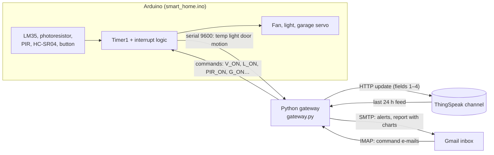

# Arduino Smart Home (IoT)

A small smart-home system built for a university Internet of Things course. An Arduino reads temperature, light, motion and distance, and drives a fan, a light and a garage door. A Python gateway on a PC forwards the readings to [ThingSpeak](https://thingspeak.com/), sends e-mail alerts on motion, and lets you control the house by e-mail. Code comments, serial messages and e-mails are in Serbian.

## Features

- **Ventilation:** the fan turns on above 30 °C and off below 24 °C (hysteresis), when ventilation mode is on.
- **Lighting:** a push button toggles the light; an automatic mode turns it on when the room is dark (light < 30 %); a motion mode keeps it on for about 10 s after the PIR sensor fires.
- **Garage:** in garage mode the servo opens the door when the ultrasonic sensor sees a car closer than 10 cm and closes it otherwise.
- **Cloud logging:** temperature, light, door openings and motion events go to a ThingSpeak channel (fields 1–4).
- **E-mail:** an alert on every motion event, a report with charts on request, and remote commands through the e-mail subject.

## Hardware

Arduino Uno (or another board with external interrupts on pins 2 and 3).

| Component | Pin | Purpose |
|---|---|---|
| LM35 temperature sensor | A0 | Temperature, 10 mV/°C |
| Photoresistor (voltage divider) | A1 | Light level, mapped to 0–100 % |
| Push button | 2 (INT0) | Toggles the light, turns off the automatic modes |
| PIR motion sensor | 3 (INT1) | Motion detection |
| HC-SR04 ultrasonic sensor | 4 (Echo), 5 (Trig) | Distance to the car |
| Servo motor | 6 | Garage door |
| LED / relay | 8 | Light |
| Fan / relay | 9 | Ventilation |

Arduino libraries: [TimerOne](https://github.com/PaulStoffregen/TimerOne) (1 s timer interrupt that reads the sensors) and ServoTimer2 (servo control on Timer2, so it does not conflict with TimerOne).

## Architecture



Once per second the Arduino sends one line over serial: `temperature light door_opened motion_detected`, for example `23.46 41.00 0 1`. The gateway forwards it to ThingSpeak and sends an alert if motion was detected.

### E-mail commands

The gateway checks the inbox every 10 s for unread e-mails with these subjects:

| Subject | Serial command | Effect |
|---|---|---|
| `UPALI VENTILACIJU` / `UGASI VENTILACIJU` | `V_ON` / `V_OFF` | Ventilation mode on/off |
| `UPALI SVETLO` / `UGASI SVETLO` | `L_ON` / `L_OFF` | Automatic light (by light level) on/off |
| `UPALI PIR` / `UGASI MOD POKRETA` | `PIR_ON` / `PIR_OFF` | Motion mode on/off |
| `OTVORI GARAZU` / `ZATVORI GARAZU` | `G_ON` / `G_OFF` | Garage mode on/off |
| `IZVESTAJ` | – | Sends a report for the last 24 h: min/max/average temperature and light, number of door openings and motion events, two charts |

The serial command `demo` turns on the garage, motion and ventilation modes at once (send it from the Arduino serial monitor).

## Setup

1. **Arduino:** open `smart_home/smart_home.ino` in the Arduino IDE, install the TimerOne and ServoTimer2 libraries, wire the parts as in the table above and upload.
2. **ThingSpeak:** create a channel with four fields (temperature, light, door, motion) and note its ID and the write and read API keys.
3. **Gmail:** use an account with 2-step verification and create an [app password](https://myaccount.google.com/apppasswords). IMAP must be enabled.
4. **Python gateway** (Python 3):

   ```bash
   python -m venv .venv
   source .venv/bin/activate        # Windows: .venv\Scripts\activate
   pip install -r requirements.txt
   cp .env.example .env             # then fill in the values
   python gateway.py
   ```

   | Variable | Meaning |
   |---|---|
   | `SERIAL_PORT` | Serial port of the Arduino, default `COM5` (e.g. `/dev/ttyACM0` on Linux) |
   | `THINGSPEAK_CHANNEL_ID` | ThingSpeak channel ID |
   | `THINGSPEAK_WRITE_KEY` / `THINGSPEAK_READ_KEY` | Channel API keys |
   | `ALERT_EMAIL` | Gmail address that receives commands and alerts (alerts are sent to itself) |
   | `ALERT_EMAIL_APP_PASSWORD` | App password of that account |

   The gateway reads `.env` if `python-dotenv` is installed, otherwise it uses the environment variables. It stops with a clear message if one is missing.

## Documentation

[`docs/iot-documentation-sr.pdf`](docs/iot-documentation-sr.pdf) is the original project documentation in Serbian (wiring table, interrupts, actuator control and serial format).

## Known limitations

- **Anyone can send commands.** The gateway only checks the e-mail subject, not the sender, so anyone who knows a subject can control the house.
- The Arduino sends data every second, but a free ThingSpeak channel accepts one update every 15 s. Most updates are rejected, and the gateway does not check the response.
- A motion alert is sent for every reading with motion, so continuous movement can send an e-mail every second.
- `OTVORI GARAZU` / `ZATVORI GARAZU` only turn the automatic garage mode on or off; they do not open or close the door directly.
- The report fails if the channel has no data for the last 24 h, and its charts are attached as files rather than shown inline. It is only sent on request, not on a schedule.
- `Serial.println` is called inside the timer interrupt, the button has no debouncing, and the PIR interrupt fires on the falling edge (end of the pulse).
- The photoresistor mapping (`map(…, 0, 60, 0, 100)`) is calibrated for the original setup and will need adjusting for other parts.
- Network errors (ThingSpeak, SMTP, IMAP) are not handled, and the gateway does not reconnect.

## License

[MIT](LICENSE)
